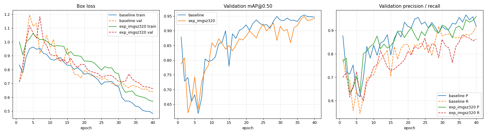

# African Wildlife Object Detection with YOLO11n
**CSCI1409 Deep Learning — Bonus Project (KBTU, Fall 2026)**
Author: Alikhan Ryskulov · Student ID 24B031980

[](https://colab.research.google.com/github/Alikhan7RK/csci1409-object-detection/blob/main/notebooks/object_detection_colab.ipynb)

**Final result (held-out test set, 205 images):** mAP@0.50 = **0.971**, mAP@0.50:0.95 = **0.808**,
precision = 0.969, recall = 0.917 · model: YOLO11n at 640 px · checkpoint: [`weights/best.pt`](weights/best.pt)

## 1. Task
Fine-tune a COCO-pretrained object detector to find and classify four African animals (**buffalo,
elephant, rhino, zebra**) with bounding boxes. Then run one controlled experiment (input image size),
pick the final model **using validation results only**, and evaluate it once on a held-out test set.
Everything can be reproduced from a fresh Google Colab runtime with the notebook.

## 2. Dataset

| | |
|---|---|
| Name | African Wildlife (Ultralytics) |
| Source | <https://docs.ultralytics.com/datasets/detect/african-wildlife/>, downloaded from <https://github.com/ultralytics/assets/releases/download/v0.0.0/african-wildlife.zip> |
| Usage terms | Distributed by Ultralytics under **AGPL-3.0** (`LICENSE.txt` inside the zip). Used here for non-commercial education. The dataset is **not** stored in this repository. `scripts/prepare_data.py` downloads it. |
| Classes | `0 buffalo`, `1 elephant`, `2 rhino`, `3 zebra` |
| Annotation format | YOLO TXT: one `.txt` per image, one line per object: `class x_center y_center width height`, all normalised to 0–1 |
| Size | 1,504 images, 2,685 boxes |

### 2.1 Official split and the problem with it
| Split | Images | buffalo | elephant | rhino | zebra | Total objects |
|---|---|---|---|---|---|---|
| train | 1052 | 399 | 558 | 399 | 575 | 1931 |
| val | 225 | 89 | 91 | 85 | 114 | 379 |
| test | 227 | 66 | 99 | 75 | 135 | 375 |

`scripts/data_report.py` searches for near-duplicates with two perceptual hashes. A pair counts as a
near-duplicate when **pHash distance ≤ 10 and dHash distance ≤ 10**. I chose these thresholds after looking
at pairs by eye: pHash alone matched different animals on similar savanna backgrounds at distance 10–12.
The search found **72 near-duplicate pairs, and 34 of them cross splits**. These are the same photograph
(sometimes resized, cropped or colour-edited) appearing in *train* and in *val/test*. Leaving them in place
would leak training images into evaluation and inflate the scores. The full list is in
[`results/data/african-wildlife/duplicates.csv`](results/data/african-wildlife/duplicates.csv).

### 2.2 Leak-free split used in this project
`scripts/make_clean_split.py` groups duplicates with union-find. **Every group that spans more than one
split is moved to train**, and all other images keep their official split. The rule is deterministic,
so no random seed is involved. 32 images moved (10 from val, 22 from test). They are listed in
[`results/data/split_changes.csv`](results/data/split_changes.csv). After the change the report shows
**0 cross-split duplicates**.

| Split | Images | buffalo | elephant | rhino | zebra | Total objects |
|---|---|---|---|---|---|---|
| train | 1084 | 417 | 565 | 413 | 587 | 1982 |
| val | 215 | 86 | 87 | 79 | 111 | 363 |
| test | 205 | 51 | 96 | 67 | 126 | 340 |
| **total** | **1504** | **554** | **748** | **559** | **824** | **2685** |

Each image is a separate photo (no video frames). The remaining 38 duplicate pairs are within the same
split, which is allowed. Every image has at least one object.

### 2.3 Label quality checks
* **Format checks** (`data_report.py`) cover missing label files, empty files, wrong field count,
  invalid class ids, coordinates outside 0–1, boxes extending past the image, boxes under 4 px and
  duplicate boxes. **No issues were found.** Duplicate image pairs also always have the same class labels.
* **Missing / wrong-label check** (`check_missing_labels.py`): a COCO-pretrained YOLO11m acts as a
  second opinion. COCO already knows *elephant* and *zebra*. A confident COCO detection (conf ≥ 0.5) that
  overlaps no ground-truth box is a **missing-label candidate**. COCO has no *rhino* or *buffalo* class (it
  calls rhinos "elephant"), so those overlaps are ignored. The check flagged **123 boxes in 87 images**
  (90 in train, 19 in val, 14 in test). I inspected the 12 most confident by eye, and nearly all are real:
  * **Missing labels** on animals that are **cut off at the image edge** (`train/4 (256).jpg`,
    `train/2 (116).jpg`, `train/2 (33).jpg`), **small or distant** (`train/2 (360).jpg`,
    `test/2 (290).jpg`, `train/2 (237).jpg`) or **partly hidden** behind other animals
    (`train/2 (5).jpg`, `val/4 (32).jpg`).
  * **One wrong class label:** `train/3 (374).jpg` shows a rhino but is labelled **zebra**.

  I did **not** re-label anything, so the dataset stays the published one. The list is in
  [`results/data/label_check_candidates.csv`](results/data/label_check_candidates.csv) and the examples are in
  [`results/data/label_check_candidates.jpg`](results/data/label_check_candidates.jpg). These labelling gaps
  also explain some of the test-set "false positives" in section 7.

Ground-truth examples (training split):


## 3. Setup and how to run

**Reproducibility check:** I ran the whole notebook twice from a fresh Colab runtime (19 and 20 Nov 2026).
Both runs gave **identical** precision, recall and mAP values for every run and split (seed 42,
`deterministic=True`). Only the wall-clock training times differed by a few seconds. The notebook in
`notebooks/` is saved **with the outputs** of the second run, and `results/` and `weights/best.pt` come
from that same run.

**Colab (recommended):** click *Open in Colab*, select `Runtime → Change runtime type → T4 GPU`, then
`Runtime → Run all`. The notebook clones this repo, installs the pinned dependencies, downloads and cleans
the data, trains both runs, compares them, evaluates on test, shows predictions and failure cases, and
downloads `outputs.zip`.

**Local / command line:**
```bash
git clone https://github.com/Alikhan7RK/csci1409-object-detection.git
cd csci1409-object-detection
pip install -r requirements.txt                       # + PyTorch for your machine
python scripts/prepare_data.py                        # download dataset
python scripts/data_report.py --data datasets/african-wildlife.yaml
python scripts/make_clean_split.py                    # leak-free split
python scripts/data_report.py --data datasets/african-wildlife-clean.yaml
python scripts/check_missing_labels.py
python scripts/train.py --config configs/baseline.yaml
python scripts/train.py --config configs/exp_imgsz320.yaml
python scripts/evaluate.py --weights runs/baseline/weights/best.pt --split val --imgsz 640 --name baseline
python scripts/evaluate.py --weights runs/exp_imgsz320/weights/best.pt --split val --imgsz 320 --name exp_imgsz320
python scripts/compare_runs.py                        # writes results/final_run.json
python scripts/evaluate.py --weights <final weights> --split test --imgsz <final imgsz> --name final
python scripts/predict_and_failures.py --weights <final weights> --imgsz <final imgsz>
python scripts/collect_outputs.py
```

**Use the trained model only:**
```python
from ultralytics import YOLO
model = YOLO("weights/best.pt")       # or download it from the link in section 6
model.predict("some_image.jpg", conf=0.25, save=True)
```

### Repository layout
| Path | Purpose |
|---|---|
| `notebooks/object_detection_colab.ipynb` | End-to-end Colab notebook (generated by `scripts/build_notebook.py`) |
| `requirements.txt` | Pinned versions: `ultralytics==8.4.215`, `imagehash==4.3.2`, `tabulate==0.10.0` |
| `configs/african-wildlife.yaml` | Dataset config (classes, split folders) |
| `configs/baseline.yaml`, `configs/exp_imgsz320.yaml` | Training configs of the two runs (differ **only** in `imgsz`) |
| `scripts/` | Data download, data report, split cleaning, label check, training, evaluation, comparison, failure analysis |
| `results/` | Saved evidence: data reports, logs (`results.csv`), learning curves, metrics JSON, predictions, failures |
| `weights/best.pt` | Final checkpoint |

## 4. Training

| Setting | Value |
|---|---|
| Framework | Ultralytics **8.4.215**, PyTorch 2.14.1 (CUDA 13.0), Python 3.13.16 |
| Model / initial weights | **YOLO11n**, `yolo11n.pt` (COCO-pretrained, ~2.6 M parameters) |
| Image size | 640 (baseline) |
| Batch size | 16 |
| Epochs | 40 (patience 100, so early stopping never triggers and both runs train the full 40) |
| Optimizer / LR | SGD, lr0 = 0.01, final lr = lr0 × 0.01 (linear), momentum 0.937, weight decay 5e-4, 3 warm-up epochs |
| Augmentation | Ultralytics defaults (mosaic, HSV jitter, horizontal flip, scale/translate), identical in both runs |
| Seed | 42, `deterministic=True` |
| Checkpoint selection | `best.pt` = epoch with the highest **validation** fitness (in Ultralytics 8.4 fitness = val mAP@0.5:0.95) |
| Hardware / training time | Google Colab, **NVIDIA Tesla T4**. Baseline 11.6 min, experiment 7.3 min |

Configuration: [`configs/baseline.yaml`](configs/baseline.yaml) · logs: `results/baseline/results.csv` ·
run details: `results/baseline/run_info.json`.

### Learning curves


Full Ultralytics plots for each run: [`results/baseline/results.png`](results/baseline/results.png),
[`results/exp_imgsz320/results.png`](results/exp_imgsz320/results.png).

* **No overfitting.** Validation box loss falls until the last epoch (0.64 at epoch 40), and the best
  checkpoint of both runs is **epoch 37**. A few more epochs could still help slightly.
* The **early dip** (epochs 2–7) happens while the new 4-class detection head replaces the COCO head under
  the warm-up learning rate. Validation mAP recovers by epoch 10.
* The **sharp drop in training loss at epoch 30** is expected. Ultralytics switches off mosaic augmentation
  for the last 10 epochs (`close_mosaic=10`), so the training images suddenly become easier.

## 5. Controlled experiment: image size 640 → 320

**Changed:** `imgsz` only. **Fixed:** data split, initial checkpoint (`yolo11n.pt`), seed, epochs, batch,
optimizer, learning rate, augmentation.

**Hypothesis (stated before training):** the animals are large in most images. The median box covers
15 % (zebra) to 32 % (buffalo) of the image area. So halving the input resolution to 320 should lower
validation mAP@0.50 only slightly (≤ 3 points), while training and inference get noticeably faster. Most
of the loss should come from small or distant animals and from herds, where an animal shrinks to a few
pixels at 320.

**Validation results** (215 images; eval conf = 0.001, NMS IoU = 0.7; T4 GPU):

| Run | Changed setting | Val precision | Val recall | Val mAP@0.50 | Val mAP@0.50:0.95 | Training time (min) | Inference (ms/img) |
|---|---|---|---|---|---|---|---|
| **baseline** | imgsz = 640 | **0.965** | **0.882** | **0.954** | **0.803** | 11.6 | 3.6 |
| exp_imgsz320 | imgsz = 320 | 0.945 | 0.870 | 0.949 | 0.774 | **7.3** | **2.4** |
| difference | | −0.020 | −0.012 | **−0.005** | **−0.029** | **−37 %** | **−35 %** |

Per class (val mAP@0.50 / mAP@0.50:0.95):

| Class | baseline (640) | experiment (320) |
|---|---|---|
| buffalo | 0.944 / 0.811 | 0.970 / 0.799 |
| elephant | 0.954 / 0.792 | 0.923 / 0.759 |
| rhino | 0.965 / 0.848 | 0.962 / 0.823 |
| zebra | 0.950 / 0.759 | 0.941 / 0.714 |

**Explanation.** The hypothesis was **confirmed**. Halving the resolution cost only **0.5 points of
mAP@0.50**, far below the 3-point limit I predicted, while training became 37 % faster and inference 35 %
faster. The animals are large, so at IoU 0.5 they are still found at 320 px.

The cost appears in the **stricter metric**: mAP@0.50:0.95 dropped by **2.9 points**. At 320 px each pixel
covers twice as much of the scene, so box edges are less precise. The model still finds the animal, but the
box fits it less tightly. The biggest losses were for **zebra (−4.4 points mAP@0.50:0.95)** and
**elephant (−3.3)**. Those are the classes that most often appear as herds of small, overlapping animals,
which is exactly where I expected the low resolution to hurt. Buffalo's mAP@0.50 went *up* by 2.6 points.
With only 86 buffalo boxes in val and a single training seed, I read that as noise rather than a real gain.
Overall, 320 px is a good choice when speed matters (for example on a camera trap), and 640 px is better
when box accuracy matters.

**Final run selection rule:** highest validation mAP@0.50. If the two runs are within 0.005, the higher
mAP@0.50:0.95 wins. The test set was not used for this choice. **Selected run: baseline (imgsz 640).**
The mAP@0.50 gap (0.0047) is within 0.005, so the tie-break decided: the baseline's mAP@0.50:0.95 is
0.803 against 0.774. The choice is recorded in [`results/final_run.json`](results/final_run.json).

## 6. Final test results

Final checkpoint: [`weights/best.pt`](weights/best.pt) · direct download:
`https://github.com/Alikhan7RK/csci1409-object-detection/raw/main/weights/best.pt`

**Held-out test set** (205 images, 340 objects), final model = baseline `best.pt`, imgsz 640:

| Class | Precision | Recall | mAP@0.50 | mAP@0.50:0.95 |
|---|---|---|---|---|
| buffalo | 0.995 | 0.922 | 0.967 | 0.837 |
| elephant | 0.952 | 0.865 | 0.960 | 0.764 |
| rhino | 0.985 | 0.977 | 0.987 | 0.881 |
| zebra | 0.945 | 0.905 | 0.971 | 0.751 |
| **all** | **0.969** | **0.917** | **0.971** | **0.808** |

Test results are close to validation (mAP@0.50 0.971 vs 0.954), so the model generalises to unseen photos
and the validation-based model choice was not overfitted to val. Elephant and zebra have the lowest
mAP@0.50:0.95, matching the herd/occlusion failures below. Confusion matrix:
[`results/eval_plots/final_test/confusion_matrix.png`](results/eval_plots/final_test/confusion_matrix.png).

At the deployment threshold **conf = 0.25**, the model made 358 predictions on test: 320 correct, 31 false
positives, 5 badly placed boxes and 2 wrong classes. It missed 20 of the 340 animals, giving
**precision 0.894 and recall 0.941** at that threshold. 163 of 205 test images (80 %) had no error at all
([`results/test_predictions/summary.json`](results/test_predictions/summary.json)).

**Evaluation settings:** confidence threshold **0.001** (keeps almost every prediction so the full
precision–recall curve can be measured), NMS IoU **0.7**, and a match counts as correct when **IoU ≥ 0.50**
with a ground-truth box of the same class. The prediction images and failure analysis use conf **0.25**.

**What the metrics mean**
* **Precision**: of all boxes the model predicted, the fraction that are correct (right class, IoU ≥ 0.5).
  Low precision means many false alarms.
* **Recall**: of all real animals, the fraction the model found. Low recall means missed animals.
  (Ultralytics reports P and R at the confidence threshold that gives the best F1.)
* **mAP@0.50**: for each class, the area under the precision–recall curve when "correct" means IoU ≥ 0.5,
  averaged over the 4 classes. It summarises performance over all confidence thresholds.
* **mAP@0.50:0.95**: the same, averaged over IoU thresholds 0.50, 0.55 … 0.95, so it also rewards tight boxes.

Test predictions at conf ≥ 0.25 (box, class, confidence; solid = correct, dashed = error):


## 7. Failure analysis
`scripts/predict_and_failures.py` matches every prediction (conf ≥ 0.25) to the ground truth and marks
each image as **missed**, **false positive**, **wrong class** or **poor box**. Galleries:
`results/test_predictions/failures_*.jpg` (left: ground truth, right: prediction).

**1. Small, distant animals in herds are missed.**
In `test/2 (130).jpg` (a herd of elephants far away across a river) the model found 7 of 10 elephants. The
3 smallest, overlapping ones were missed or got low-confidence, badly placed boxes (0.28).
`test/4 (294).jpg` (a distant zebra herd) shows the same pattern of lower confidences (0.33–0.44).
*Cause:* each animal is only a few dozen pixels wide even at 640 px, and most training photos show large,
centred animals. This also explains why zebra and elephant suffered most in the 320 px experiment.

**2. Overlapping and partly hidden animals get merged or split boxes.**
In `test/2 (97).jpg` the middle elephant is mostly hidden behind the front one. Its predicted box covers
only the visible slice (IoU < 0.5), so it counts as a poor box and a miss. In `test/4 (116).jpg` (a dark
webcam frame) two overlapping zebras were merged into **one** box. In `test/4 (81).jpg` the white fence
bars cut a zebra into pieces, and the model drew two extra partial boxes. *Cause:* NMS removes boxes that
overlap strongly, so two animals standing close together look like one object. Occluders that break up the
body shape (bars, other animals) confuse the box regression.

**3. Unusual appearances are confused with another class, and some "errors" are really missing labels.**
`test/3 (8).jpg` shows an **Indian one-horned rhino** standing in tall grass. Almost all training rhinos
are African white/black rhinos, and this one was labelled **elephant (0.39)**. In `test/3 (55).jpg` the dark
black rhino also received an extra low-confidence *buffalo* box. In `test/4 (105).jpg` a group of
**antelopes** (not one of our classes) triggered a weak *elephant* box (0.28). On the other hand, in
`test/2 (290).jpg` the two extra "false-positive" zebras at the right edge are **real zebras without
labels**. The COCO label check in section 2.3 flagged the same image. *Cause:* there are too few examples of
rhino sub-species and of non-target animals, plus the incomplete labels found in section 2.3.

Galleries: [missed](results/test_predictions/failures_missed.jpg) ·
[false positives](results/test_predictions/failures_false_positive.jpg) ·
[wrong class](results/test_predictions/failures_wrong_class.jpg) ·
[poor boxes](results/test_predictions/failures_poor_box.jpg).

**Practical next step:** fix the labels first. Review the 123 boxes flagged by
`check_missing_labels.py` and fix the rhino labelled as zebra. Then add labelled examples of distant herds
and of other rhino species, and retrain at **imgsz 640 or higher** (the experiment showed that resolution
mainly affects box precision on small animals). Correct labels will also make the test precision more
trustworthy, because some current "false positives" are real animals.

## 8. Limitations
* The dataset is small (1,084 training images) and mostly contains clear, centred photos of animals. It
  will not cover camera-trap, night/infrared or drone footage.
* Some truncated, distant or occluded animals are **not labelled** (section 2.3). This lowers measured
  precision and can confuse training.
* Duplicate detection relies on perceptual hashes. Heavily cropped or mirrored copies may still slip through.
* Moving cross-split duplicates to train makes val and test slightly smaller than the official split, so
  the numbers are not directly comparable to results reported on the official split.
* Each configuration was trained once with one seed. Differences of about 1 mAP point may be noise (for
  example, buffalo scoring higher at 320 px).
* Only YOLO11n (the smallest model) and 40 epochs were tried, because of free Colab compute.

## 9. Credits and use of assistance
* **Ultralytics YOLO** (<https://github.com/ultralytics/ultralytics>, AGPL-3.0): model, pretrained weights,
  training and evaluation code. **African Wildlife dataset** by Ultralytics.
* **My additions:** the near-duplicate search and leak-free re-split, the label checks (including the
  COCO-model second opinion), training/eval wrappers that record settings and time, the run comparison and
  selection, the matching-based failure analysis, and the Colab notebook.
* **AI assistance:** I used Claude (Anthropic) to help write the scripts, notebook and README. I reviewed,
  ran and understand all of the code and results.
