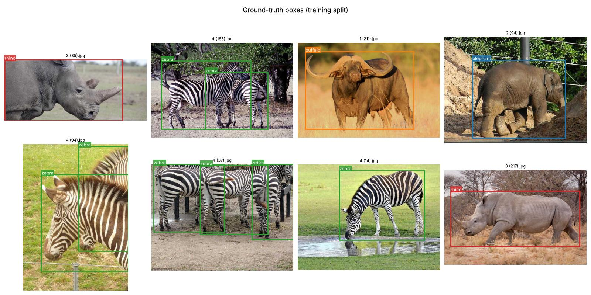
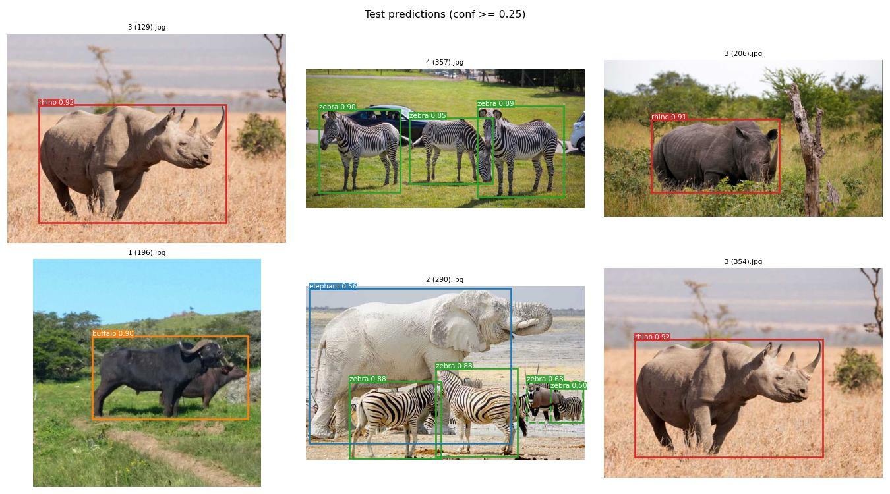

# African Wildlife Object Detection with YOLO11n
**CSCI1409 Deep Learning — Bonus Project (KBTU, Fall 2026)**
Author: Alikhan Ryskulov · Student ID 24B031980

[](https://colab.research.google.com/github/Alikhan7RK/csci1409-object-detection/blob/main/notebooks/object_detection_colab.ipynb)

> **Results status:** sections marked ⏳ are filled in from the Colab run (`outputs.zip`).

## 1. Task
Fine-tune a COCO-pretrained object detector to find and classify four African animals (**buffalo,
elephant, rhino, zebra**) with bounding boxes. Then run one controlled experiment (input image size),
pick the final model **using validation results only**, and evaluate it once on a held-out test set.
Everything can be reproduced from a fresh Google Colab runtime with the notebook.

## 2. Dataset

| | |
|---|---|
| Name | African Wildlife (Ultralytics) |
| Source | <https://docs.ultralytics.com/datasets/detect/african-wildlife/>, downloaded from <https://github.com/ultralytics/assets/releases/download/v0.0.0/african-wildlife.zip> |
| Usage terms | Distributed by Ultralytics under **AGPL-3.0** (`LICENSE.txt` inside the zip). Used here for non-commercial education. The dataset is **not** stored in this repository. `scripts/prepare_data.py` downloads it. |
| Classes | `0 buffalo`, `1 elephant`, `2 rhino`, `3 zebra` |
| Annotation format | YOLO TXT: one `.txt` per image, one line per object: `class x_center y_center width height`, all normalised to 0–1 |
| Size | 1,504 images, 2,685 boxes |

### 2.1 Official split and the problem with it
| Split | Images | buffalo | elephant | rhino | zebra | Total objects |
|---|---|---|---|---|---|---|
| train | 1052 | 399 | 558 | 399 | 575 | 1931 |
| val | 225 | 89 | 91 | 85 | 114 | 379 |
| test | 227 | 66 | 99 | 75 | 135 | 375 |

`scripts/data_report.py` searches for near-duplicates with two perceptual hashes. A pair counts as a
near-duplicate when **pHash distance ≤ 10 and dHash distance ≤ 10**. I chose these thresholds after looking
at pairs by eye: pHash alone matched different animals on similar savanna backgrounds at distance 10–12.
The search found **72 near-duplicate pairs, and 34 of them cross splits**. These are the same photograph
(sometimes resized, cropped or colour-edited) appearing in *train* and in *val/test*. Leaving them in place
would leak training images into evaluation and inflate the scores. The full list is in
[`results/data/african-wildlife/duplicates.csv`](results/data/african-wildlife/duplicates.csv).

### 2.2 Leak-free split used in this project
`scripts/make_clean_split.py` groups duplicates with union-find. **Every group that spans more than one
split is moved to train**, and all other images keep their official split. The rule is deterministic,
so no random seed is involved. 32 images moved (10 from val, 22 from test). They are listed in
[`results/data/split_changes.csv`](results/data/split_changes.csv). After the change the report shows
**0 cross-split duplicates**.

| Split | Images | buffalo | elephant | rhino | zebra | Total objects |
|---|---|---|---|---|---|---|
| train | 1084 | 417 | 565 | 413 | 587 | 1982 |
| val | 215 | 86 | 87 | 79 | 111 | 363 |
| test | 205 | 51 | 96 | 67 | 126 | 340 |
| **total** | **1504** | **554** | **748** | **559** | **824** | **2685** |

Each image is a separate photo (no video frames). The remaining 38 duplicate pairs are within the same
split, which is allowed. Every image has at least one object.

### 2.3 Label quality checks
* **Format checks** (`data_report.py`) cover missing label files, empty files, wrong field count,
  invalid class ids, coordinates outside 0–1, boxes extending past the image, boxes under 4 px and
  duplicate boxes. **No issues were found.** Duplicate image pairs also always have the same class labels.
* **Missing / wrong-label check** (`check_missing_labels.py`): a COCO-pretrained YOLO11m acts as a
  second opinion. COCO already knows *elephant* and *zebra*. A confident COCO detection (conf ≥ 0.5) that
  overlaps no ground-truth box is a **missing-label candidate**. COCO has no *rhino* or *buffalo* class (it
  calls rhinos "elephant"), so those overlaps are ignored. Spot checks of the candidates found real
  **missing labels on animals that are cut off at the image edge, very small/distant, or partly hidden**
  (for example `val/1 (296).jpg`, a distant zebra on the right edge; `val/4 (301).jpg`, a half-visible
  zebra on the left edge; `val/2 (109).jpg`, an elephant partly hidden behind a person). I did **not**
  re-label them, so the dataset stays the published one. They are listed as a limitation, and they explain
  some "false positives" at test time. ⏳ The full candidate list is in `results/data/label_check_candidates.csv`.

Ground-truth examples (training split):



## 3. Setup and how to run

**Colab (recommended):** click *Open in Colab*, select `Runtime → Change runtime type → T4 GPU`, then
`Runtime → Run all`. The notebook clones this repo, installs the pinned dependencies, downloads and cleans
the data, trains both runs, compares them, evaluates on test, shows predictions and failure cases, and
downloads `outputs.zip`.

**Local / command line:**
```bash
git clone https://github.com/Alikhan7RK/csci1409-object-detection.git
cd csci1409-object-detection
pip install -r requirements.txt                       # + PyTorch for your machine
python scripts/prepare_data.py                        # download dataset
python scripts/data_report.py --data datasets/african-wildlife.yaml
python scripts/make_clean_split.py                    # leak-free split
python scripts/data_report.py --data datasets/african-wildlife-clean.yaml
python scripts/check_missing_labels.py
python scripts/train.py --config configs/baseline.yaml
python scripts/train.py --config configs/exp_imgsz320.yaml
python scripts/evaluate.py --weights runs/baseline/weights/best.pt --split val --imgsz 640 --name baseline
python scripts/evaluate.py --weights runs/exp_imgsz320/weights/best.pt --split val --imgsz 320 --name exp_imgsz320
python scripts/compare_runs.py                        # writes results/final_run.json
python scripts/evaluate.py --weights <final weights> --split test --imgsz <final imgsz> --name final
python scripts/predict_and_failures.py --weights <final weights> --imgsz <final imgsz>
python scripts/collect_outputs.py
```

**Use the trained model only:**
```python
from ultralytics import YOLO
model = YOLO("weights/best.pt")       # or download it from the link in section 6
model.predict("some_image.jpg", conf=0.25, save=True)
```

### Repository layout
| Path | Purpose |
|---|---|
| `notebooks/object_detection_colab.ipynb` | End-to-end Colab notebook (generated by `scripts/build_notebook.py`) |
| `requirements.txt` | Pinned versions: `ultralytics==8.4.215`, `imagehash==4.3.2`, `tabulate==0.10.0` |
| `configs/african-wildlife.yaml` | Dataset config (classes, split folders) |
| `configs/baseline.yaml`, `configs/exp_imgsz320.yaml` | Training configs of the two runs (differ **only** in `imgsz`) |
| `scripts/` | Data download, data report, split cleaning, label check, training, evaluation, comparison, failure analysis |
| `results/` | Saved evidence: data reports, logs (`results.csv`), learning curves, metrics JSON, predictions, failures |
| `weights/best.pt` | Final checkpoint |

## 4. Training

| Setting | Value |
|---|---|
| Framework | Ultralytics **8.4.215** (PyTorch ⏳ version from `run_info.json`) |
| Model / initial weights | **YOLO11n**, `yolo11n.pt` (COCO-pretrained, ~2.6 M parameters) |
| Image size | 640 (baseline) |
| Batch size | 16 |
| Epochs | 40 (patience 100, so early stopping never triggers and both runs train the full 40) |
| Optimizer / LR | SGD, lr0 = 0.01, final lr = lr0 × 0.01 (linear), momentum 0.937, weight decay 5e-4, 3 warm-up epochs |
| Augmentation | Ultralytics defaults (mosaic, HSV jitter, horizontal flip, scale/translate), identical in both runs |
| Seed | 42, `deterministic=True` |
| Checkpoint selection | `best.pt` = epoch with the highest **validation** fitness (in Ultralytics 8.4 fitness = val mAP@0.5:0.95) |
| Hardware / training time | ⏳ |

Configuration: [`configs/baseline.yaml`](configs/baseline.yaml) · logs: `results/baseline/results.csv` ·
run details: `results/baseline/run_info.json`.

⏳ Learning curves: `results/baseline/results.png`, `results/exp_imgsz320/results.png`, and both runs together in
`results/learning_curves_comparison.png`.

## 5. Controlled experiment: image size 640 → 320

**Changed:** `imgsz` only. **Fixed:** data split, initial checkpoint (`yolo11n.pt`), seed, epochs, batch,
optimizer, learning rate, augmentation.

**Hypothesis (stated before training):** the animals are large in most images. The median box covers
15 % (zebra) to 32 % (buffalo) of the image area. So halving the input resolution to 320 should lower
validation mAP@0.50 only slightly (≤ 3 points), while training and inference get noticeably faster. Most
of the loss should come from small or distant animals and from herds, where an animal shrinks to a few
pixels at 320.

⏳ **Validation results** (eval conf = 0.001, NMS IoU = 0.7):

| Run | Changed setting | Val precision | Val recall | Val mAP@0.50 | Val mAP@0.50:0.95 | Training time (min) |
|---|---|---|---|---|---|---|
| baseline | imgsz = 640 | ⏳ | ⏳ | ⏳ | ⏳ | ⏳ |
| exp_imgsz320 | imgsz = 320 | ⏳ | ⏳ | ⏳ | ⏳ | ⏳ |

⏳ **Explanation:** _(written after the run: was the hypothesis confirmed? which classes and which objects
lost the most? what was the speed/accuracy trade-off?)_

**Final run selection rule:** highest validation mAP@0.50. If the two runs are within 0.005, the higher
mAP@0.50:0.95 wins. The test set was not used for this choice. ⏳ Selected run: …

## 6. Final test results

Final checkpoint: [`weights/best.pt`](weights/best.pt) · direct download:
`https://github.com/Alikhan7RK/csci1409-object-detection/raw/main/weights/best.pt`

⏳ **Held-out test set** (205 images, 340 objects):

| Precision | Recall | mAP@0.50 | mAP@0.50:0.95 |
|---|---|---|---|
| ⏳ | ⏳ | ⏳ | ⏳ |

Per-class results are in `results/metrics/final_test.json`.

**Evaluation settings:** confidence threshold **0.001** (keeps almost every prediction so the full
precision–recall curve can be measured), NMS IoU **0.7**, and a match counts as correct when **IoU ≥ 0.50**
with a ground-truth box of the same class. The prediction images and failure analysis use conf **0.25**.

**What the metrics mean**
* **Precision**: of all boxes the model predicted, the fraction that are correct (right class, IoU ≥ 0.5).
  Low precision means many false alarms.
* **Recall**: of all real animals, the fraction the model found. Low recall means missed animals.
  (Ultralytics reports P and R at the confidence threshold that gives the best F1.)
* **mAP@0.50**: for each class, the area under the precision–recall curve when "correct" means IoU ≥ 0.5,
  averaged over the 4 classes. It summarises performance over all confidence thresholds.
* **mAP@0.50:0.95**: the same, averaged over IoU thresholds 0.50, 0.55 … 0.95, so it also rewards tight boxes.

⏳ Test predictions (boxes, class names, confidence):



## 7. Failure analysis
`scripts/predict_and_failures.py` matches every prediction (conf ≥ 0.25) to the ground truth and marks
each image as **missed**, **false positive**, **wrong class** or **poor box**. Galleries:
`results/test_predictions/failures_*.jpg` (left: ground truth, right: prediction).

⏳ 1. **…** · cause · …
⏳ 2. **…** · cause · …
⏳ 3. **…** · cause · …

⏳ **Practical next step:** …

## 8. Limitations
* The dataset is small (1,084 training images) and mostly contains clear, centred photos of animals. It
  will not cover camera-trap, night/infrared or drone footage.
* Some truncated, distant or occluded animals are **not labelled** (section 2.3). This lowers measured
  precision and can confuse training.
* Duplicate detection relies on perceptual hashes. Heavily cropped or mirrored copies may still slip through.
* Moving cross-split duplicates to train makes val and test slightly smaller than the official split, so
  the numbers are not directly comparable to results reported on the official split.
* Each configuration was trained once with one seed. Differences of about 1 mAP point may be noise.
* Only YOLO11n (the smallest model) and 40 epochs were tried, because of free Colab compute.

## 9. Credits and use of assistance
* **Ultralytics YOLO** (<https://github.com/ultralytics/ultralytics>, AGPL-3.0): model, pretrained weights,
  training and evaluation code. **African Wildlife dataset** by Ultralytics.
* **My additions:** the near-duplicate search and leak-free re-split, the label checks (including the
  COCO-model second opinion), training/eval wrappers that record settings and time, the run comparison and
  selection, the matching-based failure analysis, and the Colab notebook.
* **AI assistance:** I used Claude (Anthropic) to help write the scripts, notebook and README. I reviewed,
  ran and understand all of the code and results.
